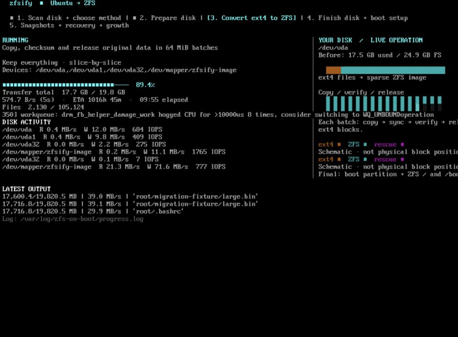
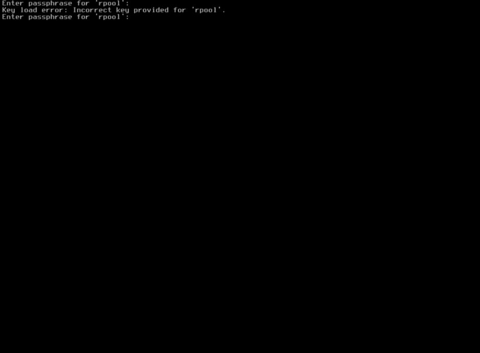
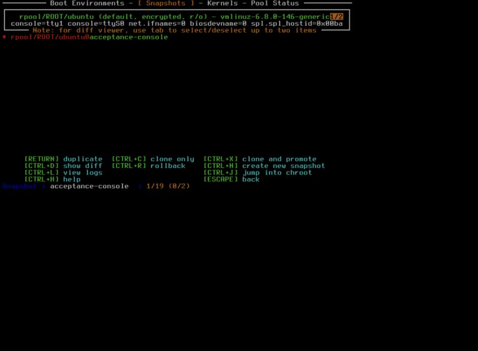

# DigitalOcean encrypted boot acceptance — 2026-10-11

Disposable Ubuntu 24.04 amd64 Droplets in SFO3, with BIOS boot, 1 GiB RAM,
25 GiB boot disks and no attached volumes. Installer SHA-256:
`7f9e233be7409fbd568264374fd52853ff537f7cd2ded120e595e8baa9e157b8`
(merged commit `1206fbf`).

## Encrypted slice-by-slice preservation

The stock ext4 root was filled to 71% usage with incompressible fixture data.
The unmodified installer ran with `--inplace --encrypt`. The passphrase was
entered using [`zfsify-unlock` in RAM](do-encryption-2026-10-11/rescue-key-entry.txt); no automatic boot key or
remote key endpoint was configured.

The installer copied 105,124 files, verified all 118,466 filesystem entries,
relocated the image onto the disk, and verified the complete manifest again.
At the first boot, ZFSBootMenu waited for a passphrase in DigitalOcean's recovery
console. An incorrect key was rejected; entering the correct key booted Ubuntu.

Post-boot checks passed for the original data hashes, accounts, SSH host keys,
ACLs, xattrs, hard links, sparse files and configuration. `/` and `/boot` were on
`rpool/ROOT/ubuntu`, inheriting AES-256-GCM encryption from `rpool`. The final
layout was a 1 GiB BIOS boot partition and a single 24 GiB ZFS partition, with
the temporary rescue partition removed. Scrub repaired 0 bytes with zero errors.
No plaintext automatic-boot hook was present.

After rebuilding every Ubuntu initramfs and rebooting, ZFSBootMenu again waited
for the passphrase. A second manual console unlock booted Ubuntu with a new boot
ID. The same preservation and encryption checks passed again, followed by
another scrub with zero errors. No installer modifications were required.

- [First manual boot, preservation, encryption and scrub](do-encryption-2026-10-11/first-manual-boot.txt)
- [Initramfs rebuild](do-encryption-2026-10-11/slice-initramfs-rebuild.txt)
- [Second manual boot, preservation, encryption and scrub](do-encryption-2026-10-11/after-rebuild-manual-boot.txt)
- [Full-manifest verification before relocation](do-encryption-2026-10-11/pre-remap-verification.txt)
- [Completed relocation and verification](do-encryption-2026-10-11/post-remap-verification.txt)
- [Native encrypted pool](do-encryption-2026-10-11/native-encryption.txt) · [First boot prompt](do-encryption-2026-10-11/slice-first-unlock.jpg) · [Second boot prompt](do-encryption-2026-10-11/slice-second-unlock.jpg)
- [Setup recording](do-encryption-2026-10-11/stage-confirmed.cast.gz) · [Conversion recording](do-encryption-2026-10-11/rescue.cast.gz)

## Encrypted erase with an HTTPS conversion key

The HTTPS endpoint supplied the conversion key only. With that endpoint stopped
and no plaintext automatic-boot hook, ZFSBootMenu waited for the passphrase in
DigitalOcean's recovery console. Entering it booted Ubuntu on encrypted ZFS.
Root, erase-mode restoration and encryption checks passed; scrub found no errors.
Rebuilding every Ubuntu initramfs, rebooting, and entering the passphrase again
also passed the same checks.

- [First manual boot and scrub](do-encryption-2026-10-11/erase-manual-boot.txt)
- [Initramfs rebuild](do-encryption-2026-10-11/erase-initramfs-rebuild.txt)
- [Checks after the second manual unlock](do-encryption-2026-10-11/erase-after-rebuild.txt)

## Encrypted 50/50 preservation and snapshot recovery

Following the [automatic-boot acceptance](do-encryption-2026-10-09.md), the
wrapping passphrase was changed in 0.734 seconds, initramfs rebuilt, and the
plaintext boot hook removed. The new passphrase unlocked ZFSBootMenu through
DigitalOcean's recovery console. A saved snapshot was selected and duplicated
using ZFSBootMenu, then booted as `rpool/ROOT/ubuntu_NEW`.

The restored environment inherited encryption from `rpool`. Its post-snapshot
marker was absent, and preservation checks passed for file contents, accounts,
SSH host keys, ACLs, xattrs, hard links, sparse files and disk layout.
The menu timeout was disabled on this fixture to allow manual menu inspection.

- [Passphrase rotation](do-encryption-2026-10-11/preserve-rotation.txt)
- [Restored snapshot boot and preservation](do-encryption-2026-10-11/preserve-snapshot-boot.txt)

All three disposable test Droplets and their API SSH keys were
[removed after testing](do-encryption-2026-10-11/cleanup.txt). Production Droplets
were not modified.
